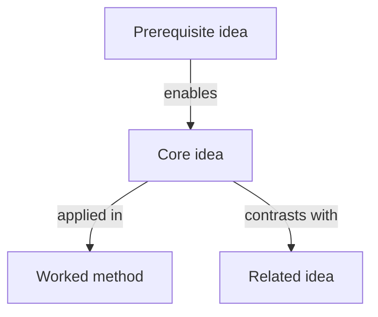
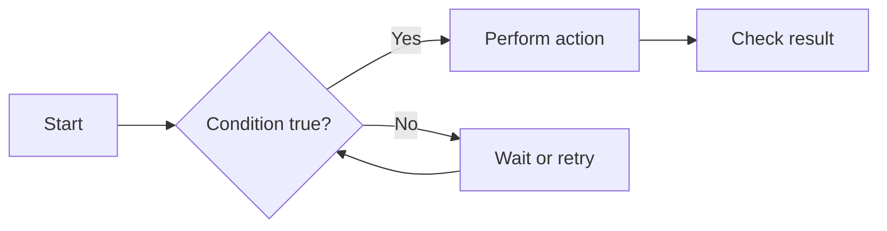

# Knowledge Diagram Guide

Read this reference when the learner requests a diagram or when a visual map would clarify several related ideas.

## Select the smallest useful diagram

Match the structure to the learning goal:

| Learning goal | Diagram |
|---|---|
| See the whole subject and its subtopics | Hierarchy or concept map |
| Decide what to learn first | Prerequisite graph |
| Follow actions or state changes | Flowchart |
| Compare methods or categories | Comparison table or branching tree |
| Trace causes and consequences | Cause-and-effect graph |
| Understand interacting components | System or data-flow diagram |
| Understand events over time | Sequence diagram or timeline |

Do not create a diagram for a single fact or a simple two-item statement that is clearer as one sentence.

## Build from the source

1. Identify the important concepts, not every noun in the material.
2. Classify each relationship: prerequisite, part-of, type-of, causes, enables, prevents, transforms, communicates with, or contrasts with.
3. Arrange concepts in the direction learners should read them.
4. Add source locators in nearby prose when pages, slides, sections, or figures are available.
5. Check every node and edge against the source. Mark prerequisite or explanatory context added by the model when it is not stated in the material.

Do not infer causation from mere proximity in the source. Do not turn a suggested learning order into a scientific causal claim.

## Mermaid conventions

Use simple Mermaid syntax that is likely to render across compatible Markdown tools.

### Concept or prerequisite map



### Process flow



Use short node text. Put detailed definitions below the diagram instead of inside nodes. Avoid styling that depends on a specific renderer.

## Text fallback

When Mermaid is unsupported, preserve the same relationships with a tree or labeled arrows:

```text
Prerequisite idea
└── enables → Core idea
    ├── applied in → Worked method
    └── contrasts with → Related idea
```

The fallback must remain useful in plain text and on narrow screens.

## Layer complex subjects

For a large chapter or course, use two levels:

1. A high-level map with roughly 5–9 major concepts.
2. Focused diagrams for dense mechanisms or individual units.

Avoid one “spaghetti diagram” containing every term. Repeated crossing arrows, long paragraphs inside nodes, and unexplained abbreviations are signs that the diagram should be split.

## Turn diagrams into active study

Use diagrams as learning tools, not decoration. Suitable exercises include:

- fill in missing nodes or relationship labels;
- reconstruct the diagram from memory;
- explain one path through the map;
- find and correct an intentionally wrong edge;
- add a new example to the correct branch; or
- compare the diagram with a similar mechanism.

For exam preparation, revisit the high-level map after practice and mark topics as not checked, developing, secure, or exam-ready based on demonstrated performance.

## Quality check

Before presenting a diagram, verify:

- every important arrow has a clear meaning;
- directionality is correct;
- the diagram agrees with the written explanation;
- model-added context is distinguishable from source content;
- the amount of detail suits the learner's current depth; and
- the diagram has an accessible prose or text explanation.
